# 🩺 MediAlert
### Automated Health Monitoring and Single-Tap Emergency Response Application

MediAlert is a web-based health monitoring and emergency response demonstration system designed to help users record, monitor, analyze and manage their health information through a centralized dashboard.

The application provides simulated health monitoring, manual health data entry, historical records, graphical analytics, emergency contact management, GPS location sharing and an SOS demonstration system.

> **Project Type:** Individual Academic Project  
> **Department:** Computer Science and Engineering (CSE)  
> **Institution:** Institute of Engineering and Management, Kolkata  
> **Academic Session:** 2026–2027

---

## 📌 1. Project Overview

Health information and emergency contact details are often maintained separately, making them difficult to access quickly when needed.

MediAlert aims to provide a centralized web application where users can maintain their health records, view health trends, manage emergency contacts and create an emergency demonstration event containing their latest available health information and location (if permission is granted).

The current version is entirely software-based and does not require external hardware or sensors.

---

## 🎯 2. Project Objectives

- Develop a centralized health monitoring web application.
- Display simulated health readings through an interactive dashboard.
- Allow users to manually enter health measurements.
- Store health records using Firebase Authentication and Cloud Firestore.
- Provide historical health records and graphical analytics.
- Maintain personal and medical profile information.
- Manage emergency contacts.
- Obtain and share the user's GPS location with permission.
- Provide an SOS demonstration that records emergency-related information.

---

## ✨ 3. Features and Functionalities

### 🔐 User Authentication
- User registration and login.
- Firebase Email/Password Authentication.
- Authenticated access to application features.

### ❤️ Health Monitoring Dashboard
- Displays simulated heart rate.
- Displays simulated blood oxygen saturation (SpO₂).
- Displays simulated body temperature.
- Shows an overall status based on demonstration thresholds.
- Provides a live graphical representation of simulated readings.

### ➕ Manual Health Data Entry
Users can manually enter:
- Heart rate.
- Blood oxygen saturation.
- Body temperature.
- Systolic and diastolic blood pressure.
- Blood sugar measurements.
- Additional notes.

### 📋 Health History
- Displays previously recorded health measurements.
- Separates manual and simulated records.
- Provides summary statistics and average readings.

### 📊 Health Analytics
- Graphical visualization of recorded health measurements.
- Time-period filters.
- Average, minimum and maximum readings.
- Historical health data analysis.

### 🧠 Intelligent Health Analysis
- Compares available measurements with general adult reference ranges.
- Provides an educational screening summary.
- Displays individual measurement analysis.
- Visualizes historical trends using graphical charts.
- Supports manual and simulated record selection.

### 📞 Emergency Contact Management
- Add emergency contacts.
- Edit and delete contact information.
- Select a primary emergency contact.
- Store contact information in Cloud Firestore.

### 📍 GPS Location Sharing
- Obtains the current location using the browser Geolocation API.
- Displays latitude, longitude and location accuracy.
- Generates a Google Maps location link.
- Supports copying or sharing the location.

### 🚨 Emergency SOS Demonstration
- Provides an SOS activation interface.
- Retrieves available emergency contact information.
- Attempts to obtain the current GPS location.
- Retrieves the latest available health readings.
- Records an emergency demonstration event in Cloud Firestore.
- Maintains emergency event history.

**Important:** The SOS functionality currently records a demonstration event only. It does not send SMS messages, emails, phone calls or notifications to emergency contacts or emergency services.

---

## 🛠️ 4. Technologies Used

| Technology | Purpose |
|---|---|
| HTML5 | Website structure |
| CSS3 | Styling and responsive layouts |
| JavaScript | Application functionality |
| Firebase Authentication | User registration and login |
| Cloud Firestore | Database and health record storage |
| Chart.js | Graphical data visualization |
| Browser Geolocation API | GPS location retrieval |
| Google Maps URL | Location visualization |
| Visual Studio Code | Development environment |
| Git and GitHub | Version control and source code hosting |
| Live Server | Local development and testing |

---

## 🏗️ 5. Project Structure

```text
MediAlert/
│
├── index.html
├── login.html
├── signup.html
├── dashboard.html
├── history.html
├── analytics.html
├── contacts.html
├── location.html
├── sos.html
├── profile.html
├── add-record.html
├── health-analysis.html
│
├── css/
│   ├── style.css
│   ├── auth.css
│   ├── dashboard.css
│   ├── history.css
│   ├── analytics.css
│   ├── contacts.css
│   ├── location.css
│   ├── sos.css
│   ├── profile.css
│   ├── add-record.css
│   ├── navigation.css
│   └── health-analysis.css
│
├── js/
│   ├── firebase.js
│   ├── auth.js
│   ├── script.js
│   ├── dashboard.js
│   ├── history.js
│   ├── analytics.js
│   ├── contacts.js
│   ├── location.js
│   ├── sos.js
│   ├── profile.js
│   ├── add-record.js
│   ├── navigation.js
│   └── health-analysis.js
│
├── screenshots/
│   ├── Add_Health_record.png
│   ├── Dashboard_1.png
│   ├── Dashboard_2.png
│   ├── Emergency_contact.png
│   ├── Emergency_SOS.png
│   ├── GPS_location.png
│   ├── Health_analytics.png
│   ├── Health_history.png
│   ├── health_profile.png
│   ├── intelligent_health_analysis.png
│   └── login.png
│
├── package.json
├── package-lock.json
├── README.md
└── .gitignore
```

---

## ⚙️ 6. Installation and Setup

Follow these steps to run MediAlert locally.

### Prerequisites

- Visual Studio Code.
- Node.js and npm.
- Git.
- A Firebase account.
- A modern web browser.
- Live Server extension for VS Code.

### Step 1: Clone the Repository

```bash
git clone https://github.com/krishkumar26t-tech/MediAlert.git
```

### Step 2: Open the Project

```bash
cd MediAlert
```

Open the project folder in Visual Studio Code.

### Step 3: Install Dependencies

```bash
npm install
```

### Step 4: Configure Firebase

1. Create a Firebase project.
2. Enable Email/Password authentication.
3. Create a Cloud Firestore database.
4. Configure the Firebase web application.
5. Add your Firebase configuration to `js/firebase.js`.
6. Configure appropriate Firestore security rules.

Keep private server credentials and service-account keys out of the repository.

### Step 5: Run the Application

Open `index.html` using the VS Code Live Server extension.

The application will run locally in your browser.

**Note:** GPS functionality requires user permission and a secure context such as localhost or HTTPS.

---

## 🗄️ 7. Database Structure

MediAlert uses Cloud Firestore to store user-specific information.

The primary database structure is:

```text
users/
  └── userId/
       │
       ├── health_readings/
       │
       ├── emergency_contacts/
       │
       ├── locations/
       │
       ├── emergency_events/
       │
       └── profile/
            └── personal
```

Each authenticated user has their own data structure based on their Firebase Authentication UID.

---

## 🔒 8. Security and Privacy

- Firebase Authentication is used for user authentication.
- Firestore security rules restrict user data access based on authenticated user UID.
- GPS location is requested only after user interaction.
- Location sharing requires browser permission.
- Personal and medical information should be handled carefully.

The application is an academic prototype and requires additional security review before handling real users' sensitive health information.

---

## ⚠️ 9. Project Limitations

- Health readings are simulated and are not obtained from actual medical sensors.
- Manual measurements depend on user-provided information.
- Health analysis is educational and is not a medical diagnosis.
- SOS creates a demonstration event in Firestore.
- Actual SMS, email and phone-call notifications are not implemented.
- The current version does not integrate external medical hardware.
- The application is a web-based prototype rather than a native mobile application.

---

## 🚀 10. Future Scope

Possible future improvements include:

- Integration with wearable health monitoring devices.
- Real-time health data collection through external sensors.
- Automated emergency SMS and email notifications.
- Integration with additional emergency response services.
- Mobile application development.
- Advanced health trend analysis.
- Improved data validation and security.
- Cloud-based deployment and production monitoring.

---

## 🖥️ 11. Project Screenshots

### 1. User Login
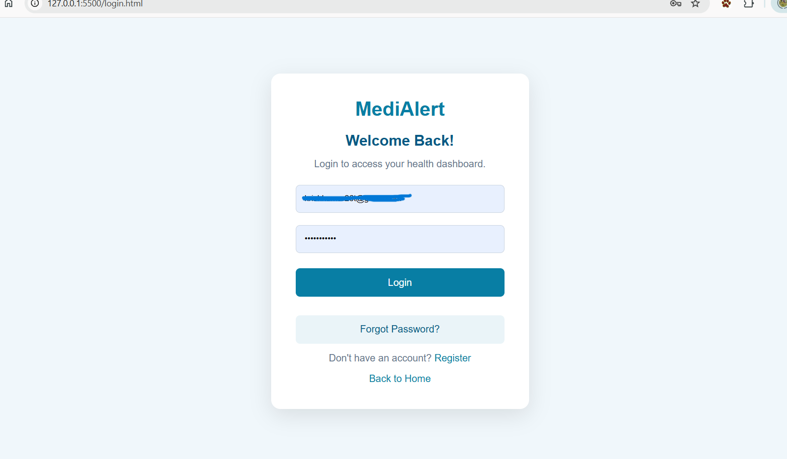

### 2. Health Dashboard
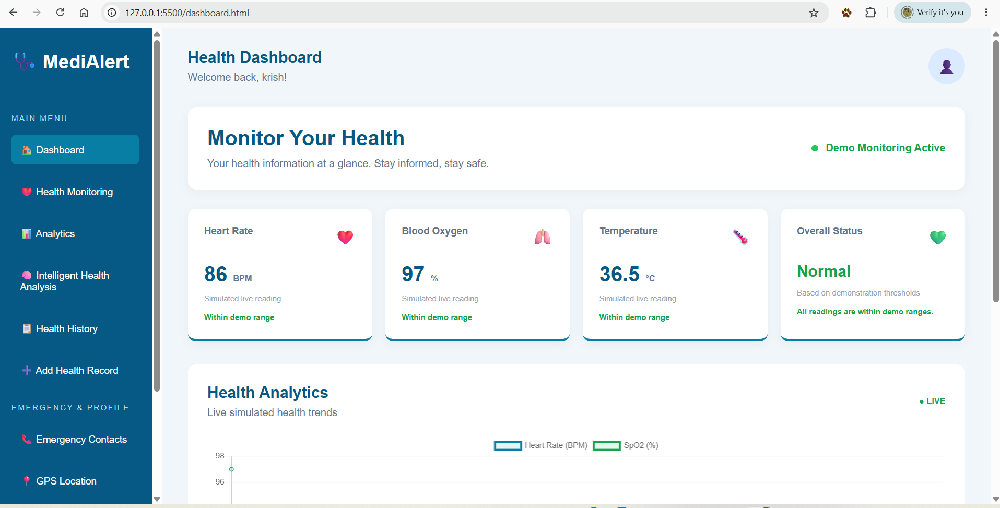

### 3. Health Dashboard – Analytics and SOS
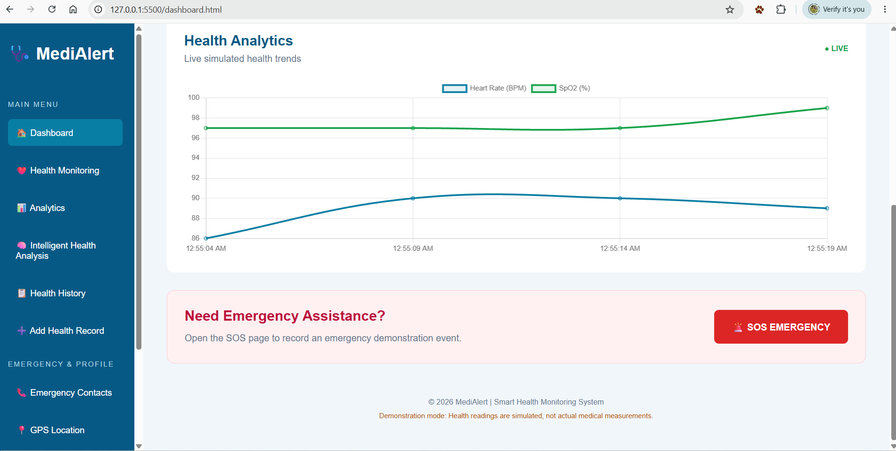

### 4. Add Health Record
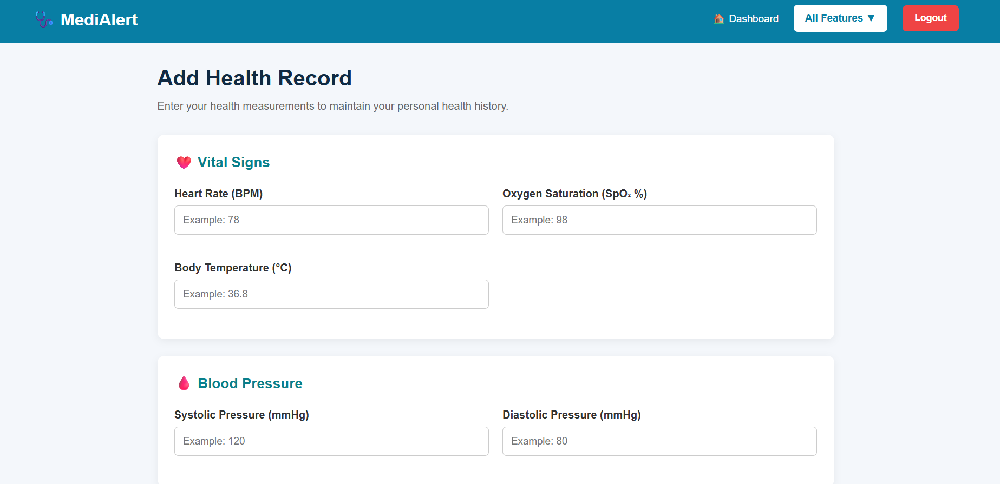

### 5. Health Analytics
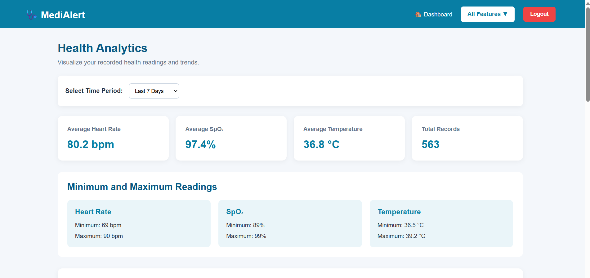

### 6. Health History
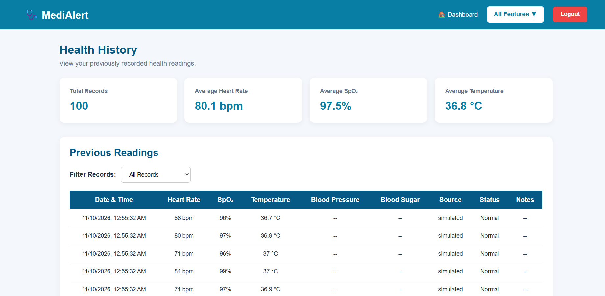

### 7. Intelligent Health Analysis
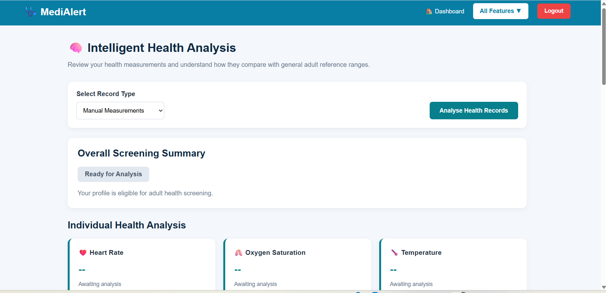

### 8. Emergency Contact Management
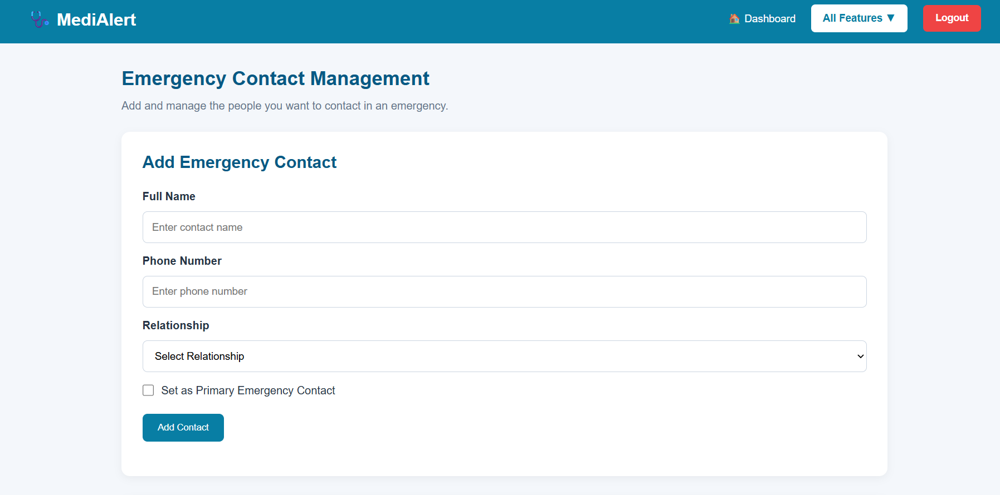

### 9. Emergency SOS
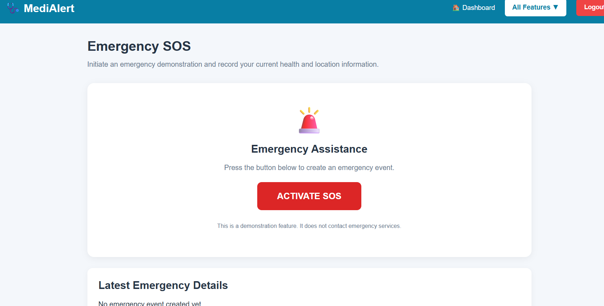

### 10. GPS Location Sharing
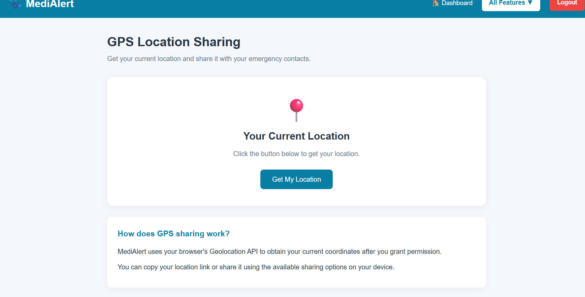

### 11. My Health Profile
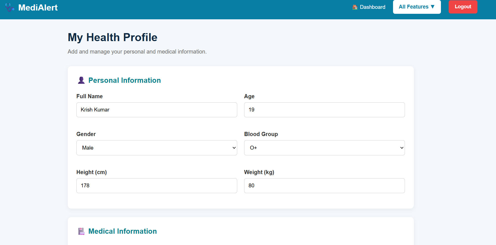

---

## 👨‍💻 12. Developer Information

**Developed by:** Krish Kumar  
**Department:** CSE (IoT, CS, BT)  
**Branch:** Computer Science and Engineering  
**Institution:** Institute of Engineering and Management, Kolkata  
**University:** University of Engineering and Management, Kolkata  
**Semester:** 3rd Semester  
**Academic Session:** 2026–2027  
**Project Mentor:** Mr. Rupayan Halder

**Project Contribution:** Individually designed and developed.

---

## 📜 13. Disclaimer

MediAlert is an academic software demonstration project. It is not a certified medical device or emergency response service.

All simulated readings are for demonstration purposes only. Health analysis must not be treated as medical advice. The SOS demonstration does not contact emergency services or notify registered contacts.

In an actual emergency, contact the appropriate emergency services directly.

---

## ⭐ Acknowledgement

This project was developed as part of the academic innovative project work for the Computer Science and Engineering department.

Special acknowledgement to the project mentor and the institution for providing academic guidance and support.

---

**Repository:** [MediAlert on GitHub](https://github.com/krishkumar26t-tech/MediAlert)

**© 2026 MediAlert | Academic Project**